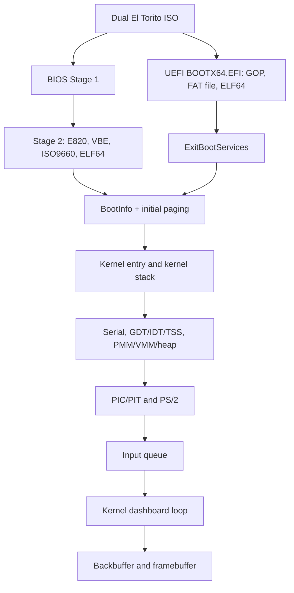

# LamOS architecture

## System model

LamOS v1.0.0 is a single-address-space, single-CPU monolithic kernel. All code runs at ring 0. Drivers deliver bounded input events to a main-loop dashboard; there is no scheduler or process model. The same static ELF64 kernel is used on every boot path.

## Boot and ownership

BIOS Stage 1 is a 512-byte boot program padded to one 2,048-byte CD sector. Firmware initially loads four 512-byte units. Stage 1 uses the xorriso boot-info table to locate the next sixteen CD sectors containing Stage 2. Stage 2 collects E820, checks long mode/NX, finds VBE graphics, reads the ISO root and buffers the kernel at physical `0x10000`. It enables A20 and protected mode, calls a freestanding 32-bit C ELF loader at `0xc000`, then enables long mode.

UEFI enters a PE32+ C application using Microsoft x64 calling conventions. The loader opens the kernel on its own ESP, selects GOP, allocates ELF segments at their declared physical locations and creates an arena below 4 GiB for BootInfo, initial paging and stack. It obtains the final map and retries `ExitBootServices` only for a stale map key. No firmware service is called after success.

Both loaders jump to `_start` with physical BootInfo in RDI. Entry immediately switches to a kernel-owned 64 KiB stack and calls System V C. Kernel validates and copies BootInfo before changing page tables. BIOS low memory stays reserved. UEFI loader/Boot Services memory becomes usable after handoff; the explicit arena remains reserved until CR3 has switched to kernel-owned tables. Runtime Services and other firmware reservations are never reclaimed.

See [the exact ABI and image layout](docs/BOOT_PROTOCOL.md).

## Address spaces and allocators

| Region | Mapping |
| --- | --- |
| Kernel physical load | Starts at `0x00100000`, ends below `0x02000000` |
| Kernel virtual address | `0xffffffff80000000 + physical address` |
| Direct physical alias | `0xffff800000000000 + physical address`, first 4 GiB |
| Kernel heap | `0xffffc00000000000`, 8 MiB |
| Loader identity alias | Present at handoff; absent after kernel VMM initialization |

The loader uses 2 MiB pages for initial mappings. The kernel creates its own four-level root, retains a 2 MiB direct map and splits leaves where 4 KiB permissions or framebuffer cache attributes are needed. Kernel text is RX, rodata is read-only/NX, and data/BSS/heap are RW/NX. Direct aliases of text/rodata are also read-only and all direct aliases are NX. CR0.WP prevents supervisor writes to read-only pages. Framebuffer pages use PCD/PWT uncached mappings. The broader bootstrap direct map includes unused physical holes; only described RAM and the framebuffer are intentionally accessed.

PMM uses used/eligible bitmaps for 4 KiB frames below 4 GiB. Usable ranges are admitted first, then all reserved overlaps are excluded. Partial frames, the first MiB, kernel, explicit loader arena and framebuffer cannot be allocated. Exhaustion returns zero; invalid/double frees panic at the kernel wrapper.

VMM owns page-table frames. `vm_map` rejects duplicate, unaligned and noncanonical mappings; `vm_query` resolves mappings; `vm_unmap` removes a leaf and invalidates its TLB entry. Mapping does not transfer ownership of the mapped frame. Intermediate page-table pages remain allocated for the kernel lifetime.

The heap is backed by PMM frames and supports 16-byte alignment, first-fit allocation, splitting and adjacent free-block coalescing. Zero-sized/oversized/exhausted allocations return null. Free validates the block list and rejects invalid/double frees. PMM/VMM/heap APIs are intended for bootstrap/main context, not IRQs or concurrent CPUs.

## Exceptions, interrupts and time

The kernel replaces loader descriptor tables with its own GDT, 104-byte TSS and 256-entry IDT. Vector 8 uses a dedicated 16 KiB IST stack. NASM stubs normalize error codes, save general registers, align the stack before calling C and return through IRETQ. C is compiled with general registers only, so interrupts do not require SIMD state saves.

Exceptions print vector/name, error, RIP, CS, RFLAGS, RSP and general registers. Page faults additionally decode CR2 and access flags. Panic disables interrupts and halts; a recursion guard handles nested panic. A framebuffer panic screen is available once graphics initializes.

The 8259 PIC maps IRQs to vectors 32–47. Unused IRQs stay masked; IRQ7/15 receive spurious-interrupt handling. PIT channel 0 provides nominal 100 Hz ticks and monotonic uptime. The idle loop uses HLT; no wall-clock or scheduling service is implied.

## Input and display

The i8042 setup uses bounded polls, controller/port tests, ACK/RESEND handling and keyboard set 2 translated to set 1. IRQ1/IRQ12 drain a bounded number of bytes and route by the auxiliary status bit. Keyboard decoding tracks extended scan codes, releases, modifiers and Caps Lock. Text events remain distinct from physical key events. Pause is consumed; complete special-key/keypad text semantics are outside v1.

The standard three-byte PS/2 mouse decoder validates packet synchronization, signed movement and overflow. It emits relative movement and individual button changes. The main loop clamps the cursor to the screen. A fixed 128-slot ring holds 127 events; overflow drops the newest event and increments a counter. There is no ISR allocation or rendering.

Graphics uses a heap-backed RGB backbuffer and clipped pixel/line/rectangle/text primitives. A small original 5×7 alphabet supplies the dashboard font; lowercase input retains its logical value while sharing uppercase glyphs. Presentation converts pixels using framebuffer pitch/channel layout and copies damaged regions. Cursor restoration uses the scene backbuffer; the cursor is composited directly to hardware after presentation.

## Build and diagnostics

CMake/Ninja builds freestanding GCC kernel C, NASM objects and GNU linker scripts. The BIOS C helper uses GCC's 32-bit code generation without SSE/MMX. Clang/LLD produces the Microsoft-ABI UEFI image using GNU-EFI declarations only. Host GCC builds reusable-library tests with its normal UBSan runtime.

Kernel UBSan uses an independent minimal GCC handler runtime and halts on the first report. The serial logger, panic and UBSan runtime are excluded from instrumentation. Assembly, the loader and uninstrumented reporting code are not covered by kernel UBSan. The linker rejects missing handler symbols. See [toolchain](docs/TOOLCHAIN.md) and [tests](docs/TESTING.md).
