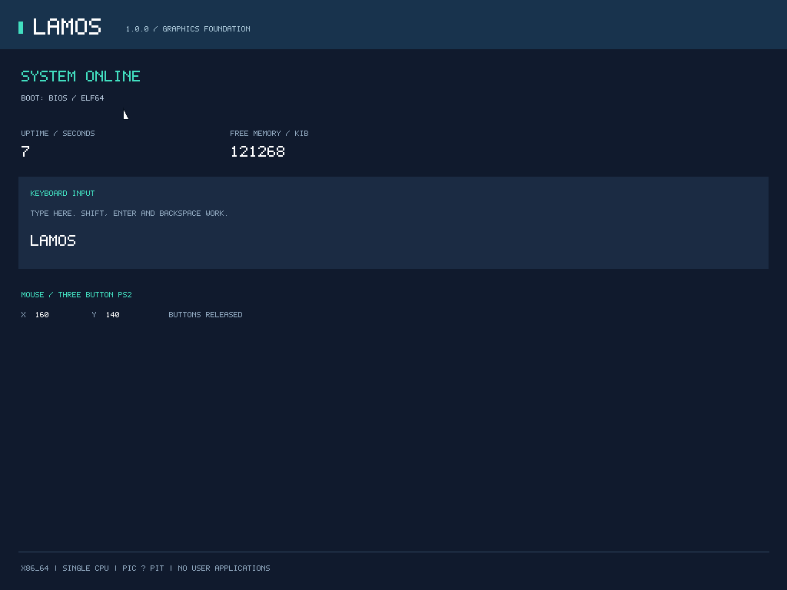

# LamOS 1.0.3

LamOS is a small desktop-oriented x86_64 operating-system foundation written in C and NASM assembly. It boots its own ELF64 kernel through custom BIOS and UEFI loaders and provides a software-rendered desktop with windows and an embedded Terminal shell.

Phase I adds the core GUI foundation. All windows run inside the single-CPU kernel. There are no independent applications, user processes, kernel filesystem, networking, USB or audio services. Physical computers and USB boot are not release targets.



After opening Terminal. The initial desktop has no open windows.

## Implemented

- Custom BIOS Stage 1/2: El Torito CD boot, E820, CPU checks, A20, VBE, ELF loading and long mode.
- Custom UEFI `BOOTX64.EFI`: GOP, the same ELF64 kernel, memory-map handoff and `ExitBootServices` retry.
- Shared versioned BootInfo, early COM1 logging, panic diagnostics and graphics panic screen.
- Kernel GDT, IDT, TSS, double-fault IST and exception register dumps.
- Physical frame allocator, four-level page tables, higher-half kernel, NX/read-only protection and a 128 MiB heap.
- 8259 PIC, 100 Hz PIT, PS/2 keyboard and three-button mouse.
- Clipped surfaces, lines/circles/polygons, premultiplied alpha, procedural icons and a complete original 8×16 printable ASCII font.
- Dirty-region compositor, 16-window manager, preview move/resize, minimize/maximize and keyboard focus.
- Multiple Terminal instances, bounded history/scrollback/editor, five shell commands, launcher/taskbar, virtual Folder and session Settings.
- CMake/Ninja presets, GDB setup, clangd, formatting/static checks, host tests, emulator input tests and UBSan diagnostics.

## Prepare the development environment

The tested host is Ubuntu 22.04 x86_64. Required host utilities include Bash, Python 3, GCC/G++, Make, Git, apt/dpkg, NASM, Clang/LLD, xorriso, mtools, QEMU, SeaBIOS, OVMF, clang-format, clang-tidy, cppcheck and GDB. A GCC cross toolchain providing `x86_64-elf-gcc`, `ld` and `objcopy` is required; the tested compiler is GCC 12.2.0. A native Linux GCC is used only for host tests.

```sh
# Download and extract pinned packages inside .tools, then build the Bochs RFB test backend.
bash tools/bootstrap.sh --bochs
. tools/env.sh
```

The bootstrap script never invokes sudo or stores passwords. It expects Ubuntu 22.04 package repositories and verifies downloaded package hashes. It supplies CMake, Ninja, clangd and GNU-EFI headers locally. See [toolchain notes](docs/TOOLCHAIN.md) for dependencies, overrides and the Bochs RFB compatibility patch.

## Build

```sh
. tools/env.sh
cmake --preset debug
cmake --build --preset debug
ctest --preset debug
```

Other presets are `release` and `ubsan`. Each produces `build/<preset>/LamOS.iso`, `kernel.elf` with symbols, `kernel.map`, `BOOTX64.EFI`, BIOS binaries, `compile_commands.json` and `SHA256SUMS`. The ISO contains BIOS and UEFI El Torito boot entries. Both embedded kernel copies are checked against the same ELF artifact during packaging.

## Run and interact

```sh
python3 tools/run.py                 # QEMU BIOS
python3 tools/run.py --uefi          # QEMU UEFI / OVMF
python3 tools/run.py --build build/ubsan
```

The desktop starts without open windows. Double-click Terminal, Folder or Settings, or use the taskbar launcher. Ctrl+Alt+T opens a Terminal. Folder and Settings are single-instance windows; Terminal supports multiple instances.

Drag a titlebar or resize edge/corner to preview geometry; release commits and Escape cancels. Titlebar buttons close, minimize and maximize/restore. Alt+Tab switches windows (including minimized windows), Alt+F4 closes focus, and taskbar buttons focus/restore or minimize the focused window. Settings changes dark/light theme, one of three backgrounds and the profiling overlay in RAM only. Folder displays embedded read-only documents, not disk files.

Terminal commands are `help`, `clear`, `sysinfo`, `meminfo` and `uptime`. Enter submits; Backspace/Delete and Left/Right/Home/End edit; Up/Down browse 32-command history and restore the draft. PageUp/PageDown browse 1,024 output lines. Ctrl+C cancels input; Ctrl+L clears output while retaining history. Input is US QWERTY printable ASCII with distinct uppercase/lowercase 8×16 glyphs.

QEMU serial output appears in the terminal. Close the emulator window to stop it. Mouse capture is controlled by the emulator; release QEMU capture with Ctrl+Alt.

## Verify and debug

```sh
python3 tools/emulator_test.py --machine bios
python3 tools/emulator_test.py --machine uefi
python3 tools/emulator_test.py --machine bochs
python3 tools/check.py
python3 tools/verify.py              # Complete release matrix and isolated fault images
```

Tests save serial logs, emulator logs, result JSON and PNG/PPM screenshots under `build/<preset>/test-results/`. Fault results live under `build/fault-*/test-results/`. Tests require permission to bind/connect localhost RFB sockets. Bochs uses the locally built backend, not the unmodified system RFB plugin, which only advertises 8-bit guest modes.

```sh
python3 tools/run.py --gdb
# In another terminal at the repository root:
gdb -x tools/kernel.gdb
```

See [architecture](ARCHITECTURE.md), [boot ABI](docs/BOOT_PROTOCOL.md), [GUI specification](docs/GUI.md), [testing and fault injection](docs/TESTING.md), [release evidence](docs/VALIDATION.md) and [change history](CHANGELOG.md).

## Compatibility limits

The acceptance configuration has 256 MiB RAM, one x86_64 CPU with long mode/NX, PIC/PIT, COM1, i8042 PS/2 devices and a linear RGB framebuffer. PMM manages addresses below 4 GiB; the heap is fixed at 128 MiB. Supported framebuffers are 640×480 through 1280×1024, packed 24/32-bit pixels; the preferred mode is 1024×768×32. UEFI currently accepts GOP RGB/BGR byte layouts. Secure Boot is disabled.

The BIOS loader supports the project ISO layout: a one-sector ISO9660 root directory and a contiguous `KERNEL.ELF;1` no larger than 4 MiB. This is a CD/DVD ISO, not a hybrid USB-disk image. Firmware and emulator setup are part of the supported configuration.

## License

Original project code, scripts, documentation and font data are licensed under [GPL-3.0-only](LICENSE). Third-party tools, firmware and GNU-EFI declarations retain their own licenses; see [THIRD_PARTY.md](THIRD_PARTY.md). No third-party bootloader implementation is included.
